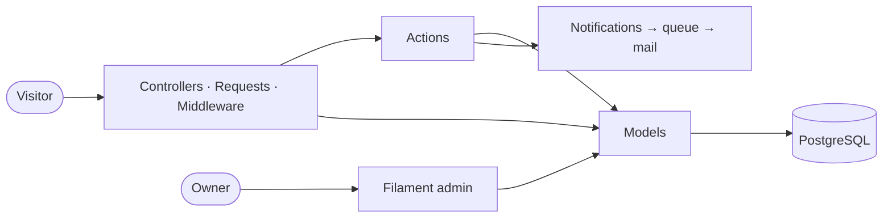

# Grager D'souza: Portfolio

[](../../actions/workflows/ci.yml)
[](../../actions/workflows/deploy.yml)


My personal site, built as a small showcase of how I like to work: **test-driven**, **strictly typed**,
**architecture enforced by tests**, and **shipped by a pipeline** that won't deploy anything red.

- **Public site**: profile, tech stack, experience timeline, projects (Markdown), contact form, sitemap.
- **Admin** at `/admin` (Filament): edit everything on the site and read contact messages, with no code changes needed.
- **Quality gates**: Pest (parallel, **100% coverage**), Pest architecture tests, Larastan at max level, Rector, Pint.
- **DevOps**: Docker for local dev and production, GitHub Actions CI/CD, deploys to **Laravel Cloud** or any container host.
- **AI tooling**: Laravel Boost (MCP server, guidelines, skills) and Laravel PAO (compact test output for agents).

| | |
|---|---|
| Runtime | PHP 8.5 · Laravel 13 · Octane + FrankenPHP |
| Frontend | Blade components · Tailwind CSS 4 · Vite 8 |
| Admin | Filament 5 · Livewire 4 |
| Data | PostgreSQL 17 · Redis 7 · SQLite (tests) |
| Testing | Pest 5 · ParaTest · PCOV · Larastan · Rector · Pint |
| Delivery | Docker · GitHub Actions · GHCR · Laravel Cloud |

> **PHP 8.6:** scheduled for general availability on 2026-11-19. CI already runs the suite on 8.6 as an experimental job.
> To switch, set `ARG PHP_VERSION=8.6` in `docker/Dockerfile` and `"php": "^8.6"` in `composer.json`.

---

## Quick start (Docker, the only host requirement)

```bash
git clone https://github.com/gragerdsouza/gragerdsouza.git && cd gragerdsouza
make setup     # build images, composer + npm install, .env, key, migrate + seed
make up        # start everything
```

| Service | URL |
|---|---|
| Website | http://localhost:8000 |
| Admin | http://localhost:8000/admin |
| Mailpit (catches all email) | http://localhost:8025 |
| Vite dev server (HMR) | http://localhost:5173 |
| PostgreSQL | `localhost:5432`: user `portfolio`, password `secret` |

**Admin login:** the seeder creates `ADMIN_EMAIL` (default `admin@example.com`) with `ADMIN_PASSWORD` from `.env`.
If `ADMIN_PASSWORD` is empty, a random password is generated. Set it and run `make fresh`.

```bash
make help      # every shortcut
make shell     # bash inside the app container
make logs      # app + queue logs
make fresh     # rebuild the database with seed data
make storage-link  # (re)create public/storage symlink for uploaded images
make down      # stop
```

<details>
<summary>Without Docker (PHP 8.5, Composer 2, Node 22 installed locally)</summary>

```bash
composer setup                       # install, .env, key, migrate, npm build
php artisan db:seed
composer dev                         # app server + queue + vite
```

On macOS without Homebrew's toolchain: `/bin/bash -c "$(curl -fsSL https://php.new/install/mac/8.5)"`.
</details>

---

## Troubleshooting

### Uploaded images (avatar) return **403 Forbidden** or don't show

Uploads are stored in `storage/app/public` and served through the symlink `public/storage`.
If the link is missing, `/storage/...` falls through to Laravel's signed private-file route and returns 403.

```bash
make storage-link                                               # Docker (recommended)
docker compose exec app php artisan storage:link --relative     # same thing, by hand
php artisan storage:link --relative                             # without Docker
```

Check it with `ls -l public/storage`. It should show `public/storage -> ../storage/app/public/`.
The `app` container also creates the link on every start, and the production image does it in `docker/entrypoint.sh`.
`--relative` makes the link work both on your machine and inside the container.

On **Laravel Cloud** the disk is ephemeral, so don't use the symlink there: attach a **public** Object Storage bucket named `public`
(see [docs/DEPLOYMENT.md](docs/DEPLOYMENT.md)).

### `http://localhost:8000` doesn't load

Give the stack a few seconds after `make up`, then check `docker compose ps` (the `app` service should be *healthy*) and `make logs`.

### Contact-form emails don't arrive

They are queued. Make sure the `queue` service is running (`docker compose ps`), then open Mailpit at http://localhost:8025.

---

## Testing & quality

```bash
make ci          # exactly what CI runs: Pint → Rector → Larastan → Pest (parallel, coverage ≥ 100%)
make test        # Pest in parallel
make coverage    # Pest + coverage gate (fails below 100%)
make lint        # Pint check        (make lint-fix to fix)
make analyse     # Larastan, max level
make rector      # Rector dry run    (make rector-fix to apply)
```

Every one of these also works as `composer <script>` inside the container or with local PHP.
Test suites, architecture rules, Filament testing and TDD workflow: **[docs/TESTING.md](docs/TESTING.md)**.

---

## Architecture



Thin final controllers, single-purpose actions, and models that know nothing about HTTP or the admin.
`tests/Arch` enforces these layers. Full diagrams (layers, ERD, request sequences, pipeline, images):
**[docs/ARCHITECTURE.md](docs/ARCHITECTURE.md)**.

---

## CI/CD

| Workflow | Trigger | Does |
|---|---|---|
| `ci.yml` | push, PR | Pint · Rector · Larastan · `composer audit` · Laravel Vet → Pest on PHP 8.5 (SQLite, with 100% coverage gate) and PostgreSQL, plus PHP 8.6 (experimental) → `npm ci && build && audit` → Docker `prod` build (pushed to GHCR on `main`) |
| `deploy.yml` | CI green on `main`, or manual. **Off until** repo variable `LARAVEL_CLOUD_DEPLOY_ENABLED=true` | POSTs the Laravel Cloud deploy hook |
| Dependabot | weekly | Composer, npm, Actions, Docker base images |

**Deploys are paused by default.** Turn them on with the repository variable `LARAVEL_CLOUD_DEPLOY_ENABLED` = `true`
(*Settings → Secrets and variables → Actions → Variables*); set it to `false` to pause again.

**Laravel Cloud setup in short:** create the app, attach Postgres + Redis + a public `public` bucket, set
build `composer install --no-dev && npm ci && npm run build && php artisan optimize && php artisan filament:optimize`,
set deploy `php artisan migrate --force`, **turn off push-to-deploy**, and add the deploy hook URL as the GitHub secret
`LARAVEL_CLOUD_DEPLOY_HOOK`. Your site is then live at `https://<app>.laravel.cloud`; add a custom domain any time.

Step-by-step for Laravel Cloud and any Docker host, plus rollback: **[docs/DEPLOYMENT.md](docs/DEPLOYMENT.md)**.

---

## Managing content

Everything on the public site is edited in `/admin`:

| Section | What |
|---|---|
| **Profile** | name, headline, tagline, bio, avatar, email, location, résumé link, social links, "available for work" |
| **Projects** | title, auto-slug, summary, Markdown body, tech-stack tags, live/repo links, featured toggle, publish date (empty = draft, future = scheduled), drag-and-drop order |
| **Skills** | name, category, order |
| **Experience** | role, company, dates (no end date = current role), summary |
| **Messages** | contact-form inbox: unread badge, opening a message marks it read, reply via email |

---

## Configuration

| Variable | Purpose | Default |
|---|---|---|
| `ADMIN_NAME` / `ADMIN_EMAIL` / `ADMIN_PASSWORD` | admin account created by the seeder | `Admin` / `admin@example.com` / random |
| `CONTACT_NOTIFY_EMAIL` | where contact-form messages are emailed | `ADMIN_EMAIL` |
| `CONTACT_RATE_LIMIT` | submissions per IP per minute | `3` |
| `RUN_MIGRATIONS` | prod image: run `migrate --force` on boot | `false` |

---

## AI-assisted development

- **Laravel Boost**: `.mcp.json` registers the Boost MCP server, which runs inside Docker
  (`docker compose exec -T app php artisan boost:mcp`, so keep `make up` running). `CLAUDE.md` / `AGENTS.md` hold
  project rules plus Boost guidelines. Update with `php artisan boost:update`.
- **Laravel PAO**: compact JSON output from Pest, PHPStan and Rector when an agent runs them.
- **Project rules** for agents (top of `CLAUDE.md`): no AI attribution in commits, full PHPDoc with `@author`,
  `@param` and `@return`, and `make ci` must pass.

---

## Project layout

```
app/                 Actions · Enums · Filament · Http · Models · Notifications · Providers
config/portfolio.php admin + contact settings
database/            migrations · factories · seeders (AdminUserSeeder, PortfolioSeeder)
docker/              Dockerfile (base/dev/vendor/assets/prod) · entrypoint · php.ini
docs/                ARCHITECTURE · DEPLOYMENT · TESTING
resources/views/     Blade pages + components
tests/               Arch · Unit · Feature (+ Feature/Admin)
.github/             CI, deploy, Dependabot, PR template
compose.yaml         local stack: app · queue · vite · pgsql · redis · mailpit
Makefile             shortcuts
```

## Contributing

See [CONTRIBUTING.md](CONTRIBUTING.md).

## License

[MIT](LICENSE) © Grager D'souza &lt;gragerdsouza@gmail.com&gt;
