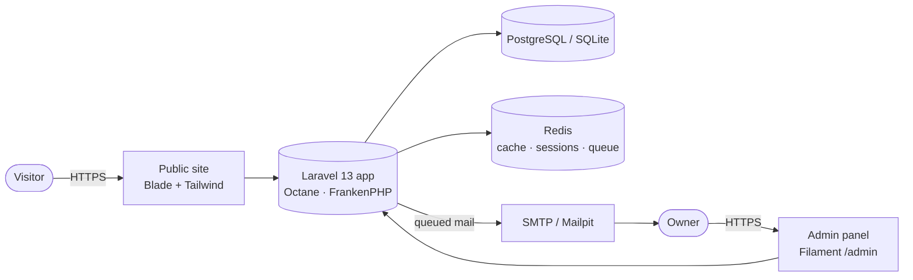
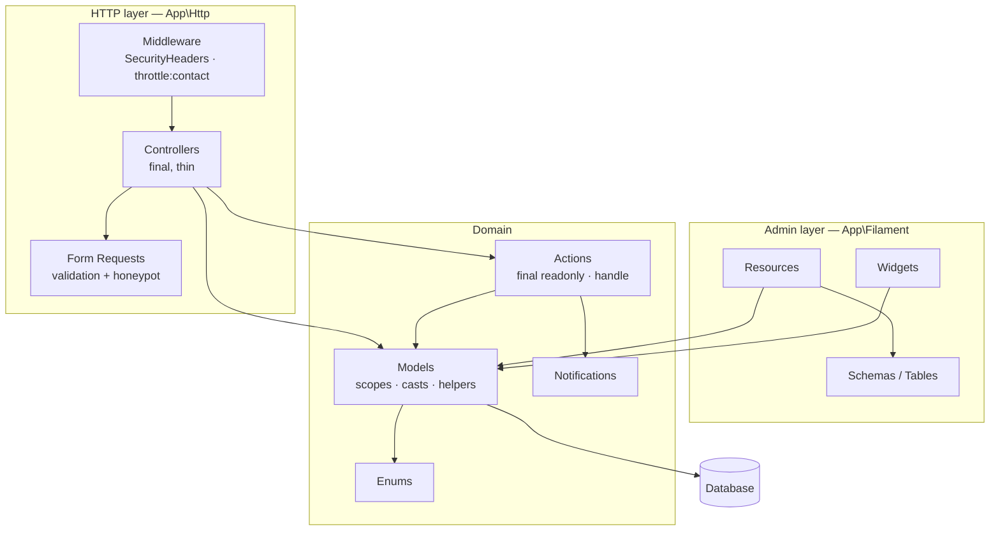
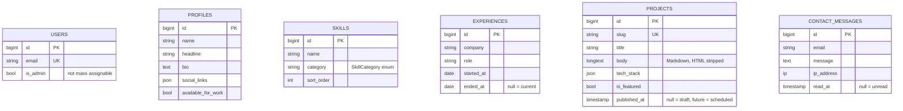
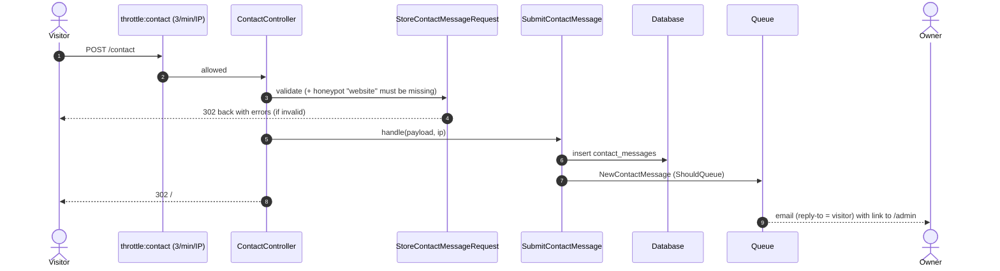
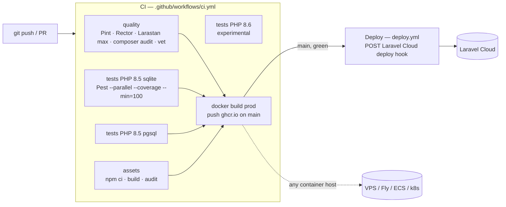

# Architecture

> Author: Grager D'souza &lt;gragerdsouza@gmail.com&gt;

A deliberately small Laravel 13 application with clear layers, a Filament admin for
content, and a delivery pipeline that refuses to ship anything below 100% test coverage.

## 1. System context



| Concern | Choice | Why |
|---|---|---|
| Runtime | PHP 8.5, FrankenPHP + Laravel Octane | One binary, worker mode, HTTP/2/3, tiny image |
| Public UI | Blade components + Tailwind 4 | Fast, zero JS framework needed for a portfolio |
| Admin | Filament 5 (Livewire 4) | Full CRUD for content in minutes, fully testable |
| Data | PostgreSQL (prod/dev), SQLite in-memory (tests) | Parity in CI via a pgsql matrix job |
| Mail | Queued notification | Contact form stays fast; retries on SMTP failure |

## 2. Layers



**Rules (enforced by `tests/Arch/ArchTest.php`, so CI fails if they are broken):**

- Every file uses `declare(strict_types=1)`.
- Controllers are `final`, suffixed `Controller`, never call `DB::` directly and never depend on each other.
- Actions are `final readonly` with one public `handle()` method and know nothing about HTTP.
- Models only extend Eloquent; they never import `App\Http`, `App\Filament` or `App\Actions`.
- The domain (`Models`, `Actions`, `Http`, `Notifications`, `Enums`) never depends on the admin layer.
- `env()` is only read inside `config/`. No `dd`, `dump`, `var_dump` or `ray` anywhere.
- Pest's `php`, `security` and `laravel` presets apply on top.

## 3. Domain model



`Profile` is a singleton: `Profile::current()` returns the saved row, or an unsaved placeholder
so the site renders before setup. The admin resource allows exactly one to be created and none deleted.

## 4. Request flows

### Contact form



### Project page

`GET /projects/{slug}`: route-model binding by `slug` → `ProjectController::show` → `abort_unless($project->isPublished(), 404)`,
so drafts and scheduled projects are never public, even if someone knows the slug.

## 5. Security

- Admin access: `User::canAccessPanel()` requires `is_admin`, which is not in `#[Fillable]`.
- Markdown is rendered with `html_input: strip` and `allow_unsafe_links: false`.
- `SecurityHeaders` middleware adds `X-Content-Type-Options`, `X-Frame-Options`, `Referrer-Policy`,
  `Permissions-Policy`, plus HSTS over HTTPS. `URL::forceHttps()` in production.
- `Model::shouldBeStrict()` outside production (catches lazy loading and silently discarded attributes).
- `DB::prohibitDestructiveCommands()` in production.
- Contact form: rate limit, honeypot, length limits.

## 6. Delivery pipeline



## 7. Runtime images (`docker/Dockerfile`)

| Stage | Based on | Used by |
|---|---|---|
| `base` | `dunglas/frankenphp:1-php8.5` + extensions | all |
| `dev` | base + Composer, Node 22, PCOV | `compose.yaml`, local tooling |
| `vendor` | `composer:2` | build: `--no-dev`, optimized autoloader |
| `assets` | `node:22-alpine` | build: `npm ci && npm run build` |
| `prod` | base + app + vendor + `public/build` | GHCR image, any container host |

`docker/entrypoint.sh` runs `optimize`, `filament:optimize`, and (when `RUN_MIGRATIONS=true`) `migrate --force`,
then hands over to Octane.

## 8. Directory map

```
app/
├── Actions/            single-purpose domain operations
├── Enums/              backed enums (also Filament labels)
├── Filament/           admin panel: Resources/{X}/{Pages,Schemas,Tables}, Widgets
├── Http/
│   ├── Controllers/    final, thin
│   ├── Middleware/     SecurityHeaders
│   └── Requests/       validation
├── Models/
├── Notifications/
└── Providers/          App + Filament panel
config/portfolio.php    admin + contact settings
docker/                 Dockerfile, entrypoint, php.ini overrides
resources/views/        Blade pages + components
tests/{Arch,Unit,Feature}
```
